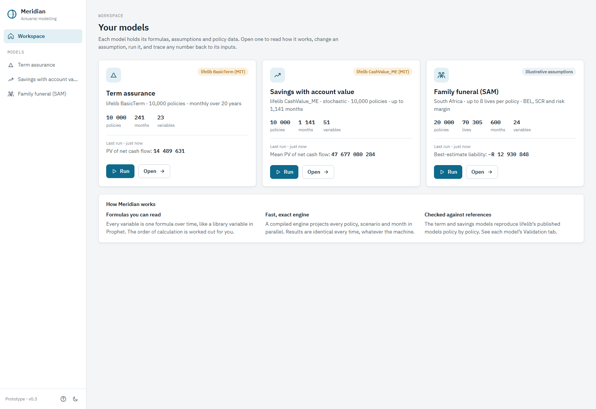
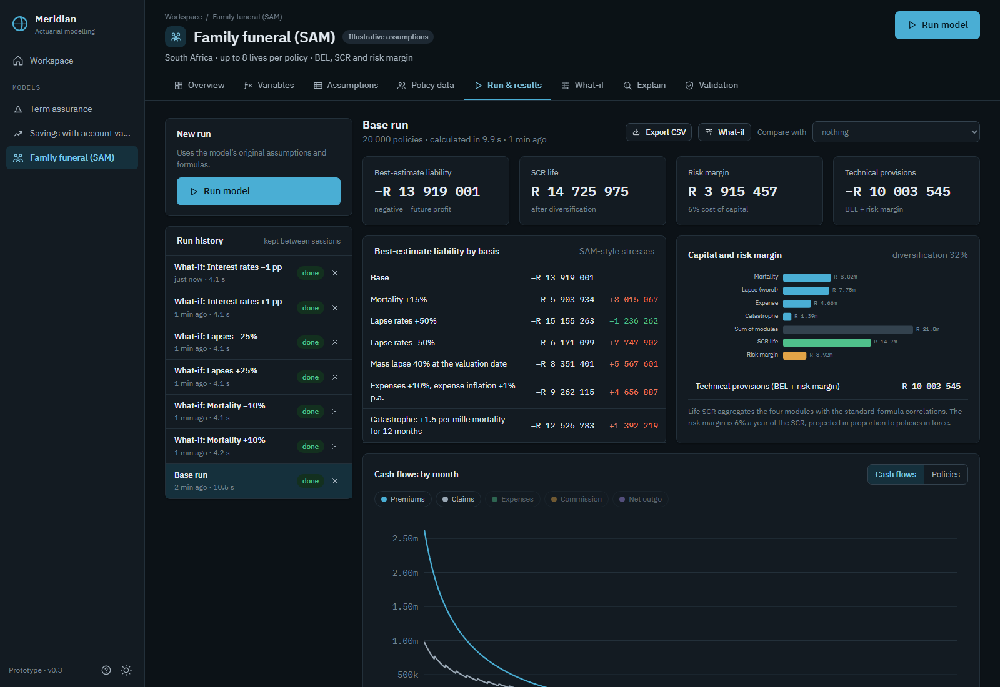
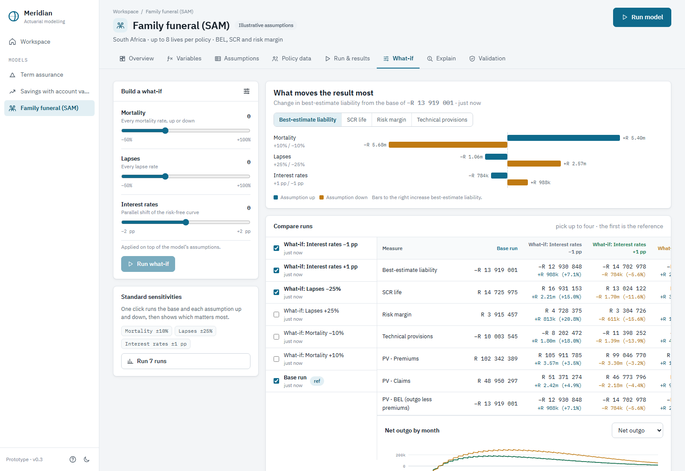
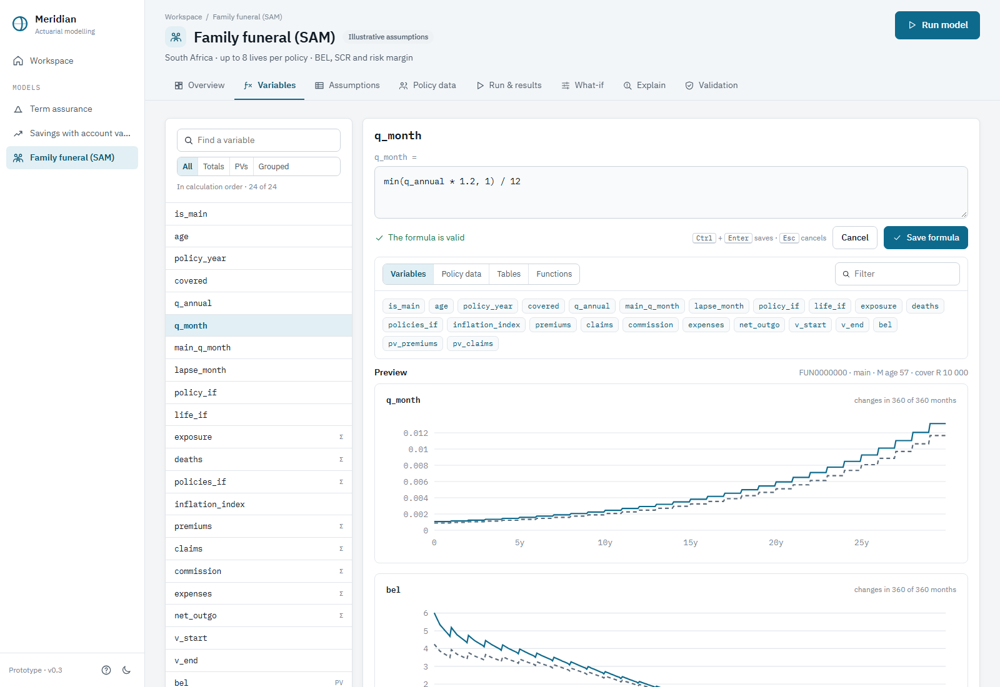
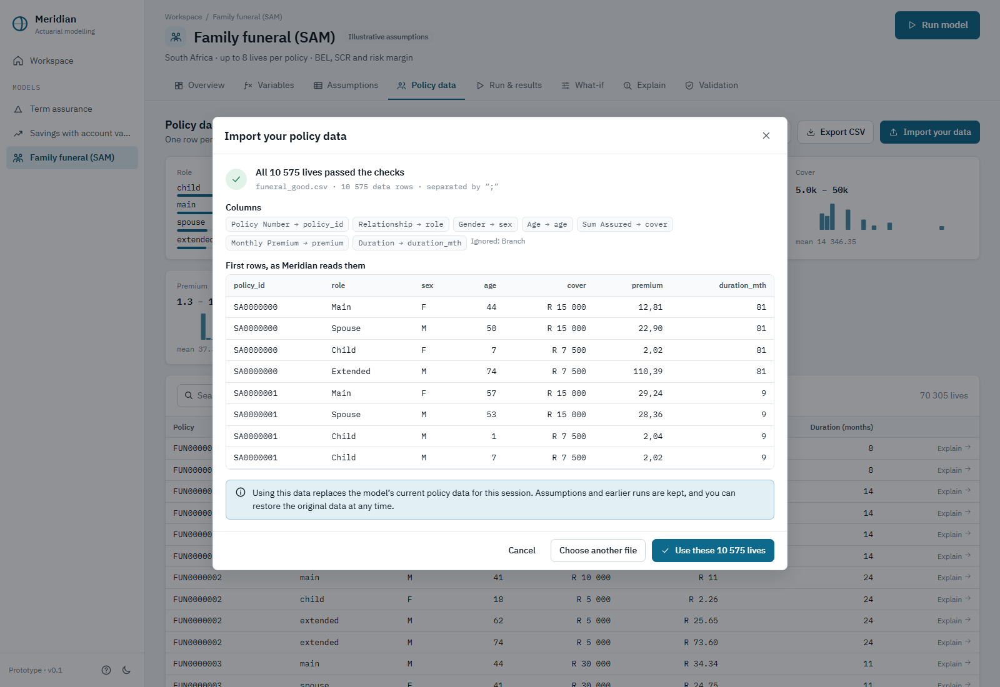

# Meridian

**A modern actuarial projection workspace: a working prototype.**

Meridian shows what an actuarial modelling platform could look like if it were designed today:
readable formulas, a fast and exact engine, results you can trace back to their inputs, and every
model checked against an independent implementation. Everything sits in one desktop app that
installs like any other Windows program.

It is a solo showcase, designed and built with an AI coding assistant (Claude). It is not a
commercial product, and its South African assumptions are illustrative.

## Download

**[Download the latest Windows installer](https://github.com/wolfxxx/Meridian/releases/latest)** (`Meridian-Setup-<version>.exe`, about 40 MB).

- Windows 10 or 11. No administrator rights, Python or other software needed.
- The installer is not code-signed, so Windows may show "Windows protected your PC". Choose
  **More info → Run anyway**.
- A one-minute tour starts the first time you open it.

## What you can do

| | |
|---|---|
| **Three working models** | Term assurance and a stochastic savings product rebuilt from the open-source [lifelib](https://lifelib.io) library. A South African family funeral product (up to 8 lives per policy) valued on a SAM basis: BEL, six stresses, life SCR with correlations, and a 6% cost-of-capital risk margin. |
| **Checked against references** | Term reproduces lifelib's 10,000 premiums to the cent. Savings matches lifelib per policy and scenario to within 4e-13. Funeral is checked against a separate loop-by-loop implementation. You can run the checks yourself in the app. |
| **Read and edit formulas** | Every variable is one formula, with a dependency graph. Edit any formula in place. It is checked as you type and previewed before and after for the first policy. |
| **What-if and sensitivities** | Sliders for mortality, lapses and interest rates. One click runs the standard sensitivities and draws a tornado chart. Compare up to four runs side by side. |
| **Your own data** | Import policy data from CSV. Columns are matched by name, every row is checked, and you see a preview before anything changes. Excel-style semicolons, decimal commas and "R 10 000" are understood. |
| **Explain any number** | Pick a policy and a month and follow a result back through its formulas to the inputs. |
| **Fast, deterministic engine** | Rust core, multi-threaded, about 270 million policy-months per second on term assurance. Results are bit-identical whatever the machine, thread count or chunk size. |

More screenshots

## What's in this repository

- **[`Prophet_Analysis_and_Competitor_Spec.md`](Prophet_Analysis_and_Competitor_Spec.md)**: a study of the actuarial projection-software
  market and a specification for a modern alternative, drawn from public sources and reviewed
  independently. Architecture decision ADR-001 (Python modelling language over a Rust engine)
  is in §25.1.
- **[`meridian/`](meridian/)**: the prototype, with its own [README](meridian/README.md) covering building, testing and benchmarks.
  - `crates/meridian-core` is the Rust projection engine; `crates/meridian-py` holds its Python bindings.
  - `python/meridian` contains the modelling language, the three models, the formula reader and the desktop app's service.
  - `ui/` is the interface (React + TypeScript).
  - `packaging/` builds the Windows installer.
- **`.github/workflows`**: CI on Windows and Linux (tests, lints, model reconciliations). The
  installer is built and published automatically for every `v*` tag.

## Notes

- Meridian is independent. It is not affiliated with, endorsed by or derived from FIS or its
  Prophet software; product names belong to their owners. No proprietary materials were used.
- The lifelib models and data are © lifelib Developers, used under the MIT licence (see
  `meridian/python/meridian/models/data/*/NOTICE.md`).
- Licensed under the [Apache License 2.0](LICENSE).
